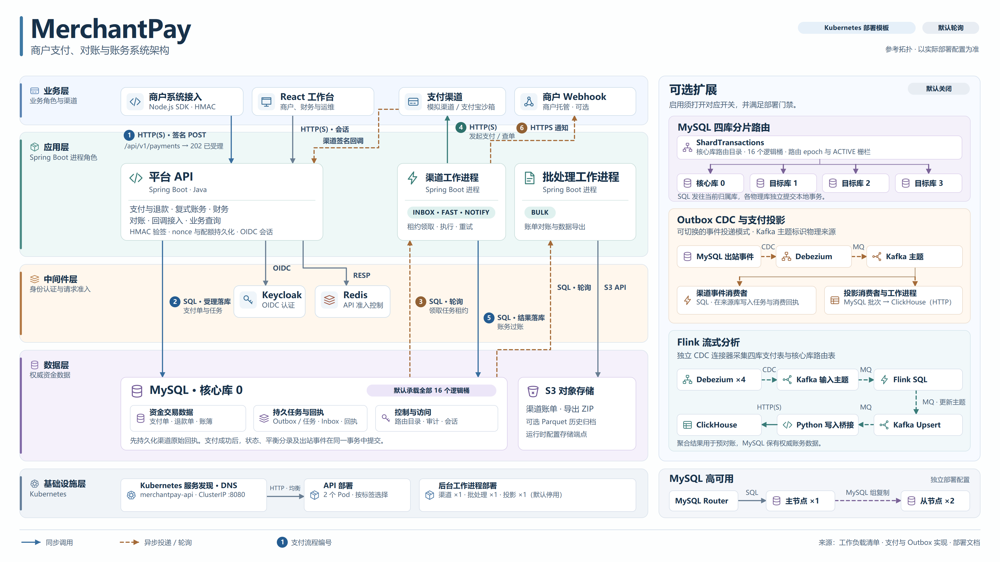

# MerchantPay · 商户支付与对账平台

MerchantPay 是一个面向商户的支付与对账项目，串联商户接入、交易处理、复式记账、渠道对账和财务处理。项目提供商户 API、网页工作台和本地渠道模拟器，便于开发者体验和验证支付链路。

## 主要功能

| 功能 | 可以做什么 |
| --- | --- |
| 商户接入 | 配置商户、创建和吊销 API 密钥。商户服务端使用 HMAC 签名调用 API，也可用 Node.js SDK 完成签名和发送。 |
| 支付与退款 | 创建支付、查询状态、申请关单，以及发起全额或部分退款。创建支付和退款时，可用原业务单号和原参数幂等重试。 |
| 复式账务 | 查看交易对应的凭证和借贷分录，核对商户余额、冻结明细和账务检查点。 |
| 渠道对账 | 上传或拉取渠道账单，与平台支付和退款记录比对，查看缺单、金额或状态不一致等差错，并下载原始账单。 |
| 调账与结算 | 围绕对账差错建立调查案件，提交和审批调账方案。财务人员可以生成、审批结算单并执行模拟核销。 |
| 通知与任务恢复 | 向配置了回调地址的商户发送签名通知，失败后按策略重试。运维人员可以查看待确认交易与失败任务，并按权限查单或重放。 |
| 工作台与导出 | 按商户、时间等条件筛选交易，异步生成并下载 ZIP 导出文件。工作台通过 Keycloak 登录，按角色和所属商户控制访问，并提供操作审计查询。 |
| 渠道模拟 | 本地演练支付、退款、关单、查单和回调，并模拟延迟或响应丢失等场景。 |
| 可选扩展 | 按部署配置启用分片路由、独立查询投影、历史归档与查询、交易指标分析及预对账。 |

[商户 API 契约](docs/api/openapi.json) · [Node.js SDK](sdk/README.md)

## 技术栈

| 用途 | 技术 |
| --- | --- |
| 后端 | Java、Spring Boot、Spring Modulith、Maven |
| 前端 | React、TypeScript、Vite、Ant Design |
| 数据与认证 | MySQL、Flyway、Keycloak（OIDC） |
| 可选组件 | Redis 请求准入、S3 对象存储、Debezium 与 Kafka 事件投递、Flink 与 ClickHouse 分析 |

## 快速开始

以下步骤使用 Windows 和 PowerShell（`pwsh`）。先准备 Maven，并启动 MySQL 和 Keycloak。在 MySQL 中建立 `merchantpay` 数据库和有迁移权限的应用账号。在 Keycloak 中配置 `merchantpay` realm、`merchantpay-console` 客户端及登录账号，客户端回调地址为 `http://127.0.0.1:8080/login/oauth2/code/keycloak`。[Keycloak 配置模板](infra/keycloak/realm.template.json)

在项目根目录安装工具链和前端依赖，首次构建时让 Maven 下载项目依赖。

```powershell
& ./scripts/bootstrap.ps1
& ./scripts/pnpm.ps1 -PnpmArguments @('install', '--frozen-lockfile')
& ./scripts/mvn.ps1 -MavenArguments @('package', '-DskipTests')
if (-not (Test-Path .env.native)) {
    Copy-Item infra/native/environment.example .env.native
}
```

填写 `.env.native` 中的数据库连接、身份服务配置和应用密钥，保存后启动应用。[环境变量模板](infra/native/environment.example)

```powershell
& ./scripts/start-local.ps1 -SkipBuild
```

启动后打开[工作台](http://127.0.0.1:5173)，用配置好的 Keycloak 账号登录。可以先创建一笔模拟支付，再试一次部分退款，并在交易详情中查看账务分录。完成后运行 `& ./scripts/stop-local.ps1` 停止应用。

## 系统架构



[查看 SVG 矢量版](diagram/merchantpay-architecture/merchantpay-architecture-zh.svg)

商户 API 和工作台共用 Spring Boot 后端。API 在同一个 MySQL 事务中保存支付单和持久任务，后台进程轮询任务并调用支付渠道。支付成功时，支付状态、复式分录和出站事件一起提交，随后按配置异步通知商户。

批处理进程负责对账和导出。四库分片、CDC 投影和流式分析默认关闭，可按部署需要启用。
